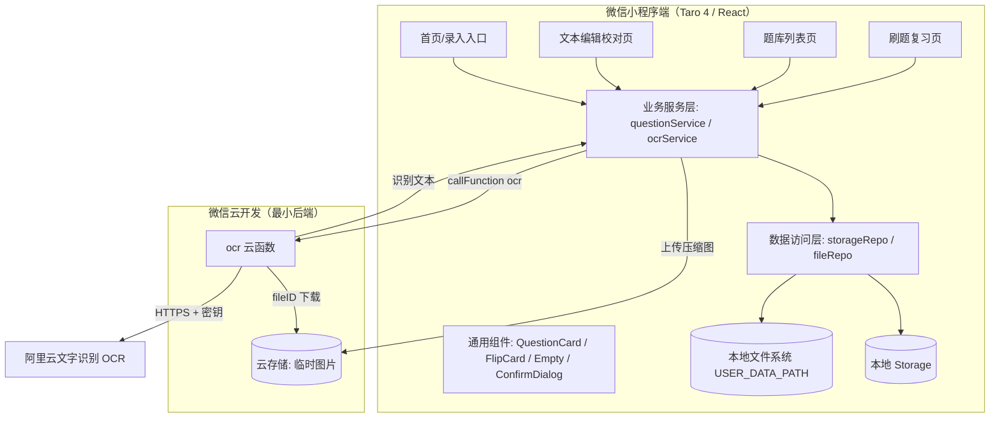
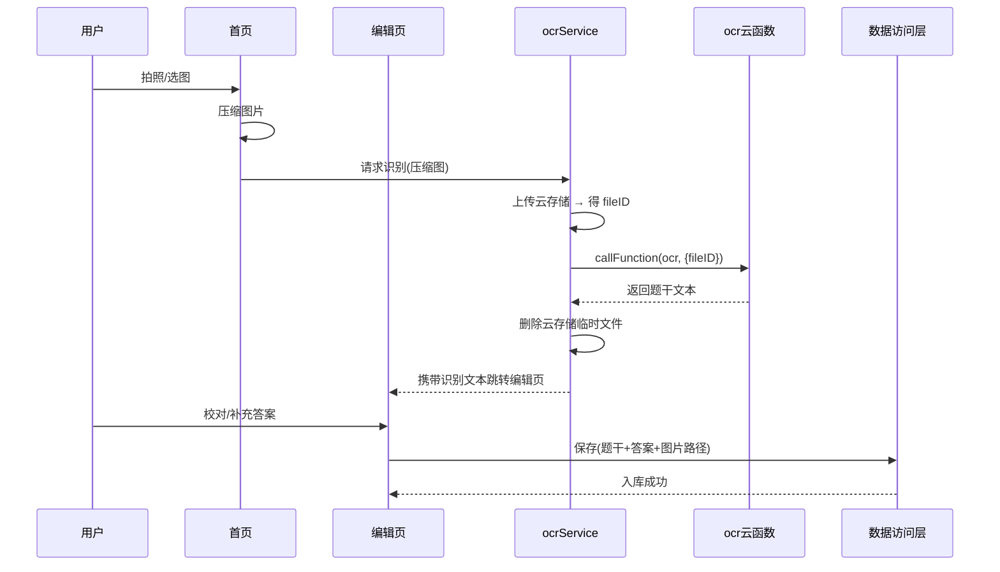

# 错题管理小程序 · 方案设计文档

> 版本：v1.1
> 对应需求文档：`需求分析文档.md`
> 文档定位：MVP 阶段的技术方案与实施路线，供开发直接落地。
> 变更记录：v1.1 将 OCR 服务由腾讯云文字识别调整为**阿里云文字识别（`ocr-api`）**。

---

## 0. 决策摘要（TL;DR）

| 决策项 | 结论 |
| --- | --- |
| 前端框架 | **Taro 4.x（React + TypeScript）** |
| 目标平台 | **仅微信小程序**（架构保留多端扩展位，但 MVP 不投入跨端成本） |
| 数据存储 | **纯本地存储**（`Taro.setStorage` + 本地文件系统），无用户体系、无业务数据库 |
| OCR 方案 | **微信云开发云函数代理第三方 OCR（阿里云文字识别）**，云函数只做密钥代理，不落库 |
| 图片存储 | **压缩后存本地文件系统**（`USER_DATA_PATH`），配额受 10MB 限制，配套容量管理 |
| 小程序主体 | 个人主体（已确认，相关能力受限须规避） |
| MVP 范围 | 手动/拍照录入 → 文本校对 → 本地入库 → 卡片列表 → 随机刷题翻面 |

> 说明：引入"云函数"仅为保护 OCR 密钥与规避个人主体限制，**不引入数据库**，业务数据 100% 留在用户本地，符合"纯本地"的既定约束。

---

## 1. 项目概述与范围界定

### 1.1 产品定位

一款基于微信小程序的**极简个人错题管理与智能刷题工具**，聚焦"高效录入 - 结构化存储 - 针对性刷题"闭环。MVP 强制题干为**纯文本**，不引入富文本、公式渲染、图文混排。

### 1.2 MVP 范围（In Scope）

| 能力 | 说明 |
| --- | --- |
| 题目采集 | 调起微信相机拍照 / 相册选图 |
| OCR 识别 | 图片转纯文本题干（不自动分类） |
| 内容校对 | 文本编辑，手动纠错并补充答案 |
| 极简入库 | 记录 = {纯文本题干, 原图地址, 答案} |
| 题库管理 | 卡片分页列表、详情预览、手动删除 |
| 随机刷题 | 随机抽题、默认遮挡答案、点击翻面显示答案与原图 |

### 1.3 明确不做（Out of Scope）

- 富文本 / LaTeX 公式 / 图文混排
- 用户登录注册、云端同步、多设备
- 学科分类、标签体系
- 掌握度标记、正确率统计、热力图
- 艾宾浩斯复习引擎、AI 变式题、文档解析

以上均为后续扩展（见第 13 章）。

### 1.4 关键约束（来自已确认决策）

1. **无后端业务服务**：所有错题数据仅存于用户手机本地。
2. **个人主体限制**：无法使用微信原生 OCR、微信支付（订阅）→ 后续"账号与订阅"扩展需企业主体，此处仅做规避设计。
3. **本地容量硬约束**：小程序 Storage 与本地文件系统各约 **10MB**，拍照原图必须压缩。
4. **密钥必须服务端**：第三方 OCR 的 AccessKey Secret 绝不能下发到小程序前端。

---

## 2. 技术选型

### 2.1 小程序开发方案横向对比（重点）

小程序生态迭代快，当前主流路线为：原生 / Taro / uni-app / uni-app x。对比如下（截至 2026 年）：

| 对比维度 | 微信原生小程序 | **Taro 4.x** | uni-app (Vue3) | uni-app x（蒸汽模式） |
| --- | --- | --- | --- | --- |
| 开发语言 | WXML/WXSS/JS/TS | **React/Vue + TS（JSX）** | Vue3 + TS | Vue + TS（可 ts/js`uts`） |
| 目标端 | 仅微信 | 微信/支付宝/抖音/百度/QQ/京东/飞书/快手小程序 + H5 + RN + 鸿蒙元服务 | 覆盖最广：多种小程序 + H5 + iOS/Android/鸿蒙 App | Android/iOS/鸿蒙/Web + 微信/支付宝小程序 |
| 微信能力适配 | 100% 原生 | 高（官方端平台插件 `@tarojs/plugin-platform-weapp`） | 高 | 小程序端适配进行中 |
| 运行性能 | 最优（零抽象层） | 接近原生（编译时转换，运行时开销小） | 接近原生 | **App 端超越原生**；小程序端与 uni-app 相当 |
| 组件/UI 生态 | WeUI、官方组件 | NutUI-React、Taroify 等 React 生态 | uni-ui、uView、插件市场（3000+） | 插件市场以 App 场景为主 |
| 工程化 / CI | 一般 | **强**（CLI 完善、插件化、`@tarojs/plugin-mini-ci`） | 强（HBuilderX） | 中 |
| 学习成本 | 低 | 中（需懂 React + Taro 架构） | 低（Vue 上手快） | 中高（新范式） |
| 包体积 | 最小 | 略大（含运行时） | 略大 | 中 |
| 社区/维护 | 官方 | 京东出品，4.x 活跃 | DCloud，900 万开发者，最活跃 | 新，2026 蒸汽模式刚落地 |
| 典型适用 | 只做微信、极致贴合 | **React 团队 + 未来多端预留** | Vue 团队 + 强多端 | 重 App 性能场景 |

**关键辨析：**

- **原生 vs Taro**：原生性能与微信能力最贴合，但无法复用前端团队（React）经验，未来扩端需重写。Taro 通过编译时转换把 JSX 转成 WXML，运行时开销很小，对"卡片列表 + 翻面动画"这类轻交互几乎无性能差异。
- **Taro vs uni-app**：两者能力接近，本质是 **React 技术栈 vs Vue 技术栈** 的选择。uni-app 生态与开发者基数更大；Taro 在工程化（CLI、插件化架构、CI）与 React 生态上更契合本项目。
- **uni-app x 蒸汽模式**：2026 年主打 **App 端渲染性能超过原生**，但其小程序端（微信/支付宝）生态仍在完善，且引入 `uts`/新范式，学习成本高，不适合以"快速跑通 MVP"为目标的本项目。

### 2.2 结论：为什么选 Taro 4（React）

1. **技术栈匹配**：项目采用 React 心智模型，Taro 直接用 `React + TS` 开发，团队/个人能力可最大化复用。
2. **仅微信但保留弹性**：MVP 只编译 `weapp`，未来若要做支付宝/抖音小程序或 H5，只需增开编译目标，无需重写业务逻辑。
3. **工程化强**：Taro CLI 开箱即用，路由/构建/多环境配置完善，后续可用 `@tarojs/plugin-mini-ci` 做自动化上传发版。
4. **生态可用**：UI 层可选 NutUI-React（京东官方，与 Taro 同源），本 MVP 因 UI 极简，优先自研少量组件。
5. **性能足够**：本项目无重动画、无长列表万级渲染（个人错题量级），Taro 的抽象开销可忽略。

> 风险提示：Taro 版本迭代较快，需锁定 `package.json` 中 `@tarojs/*` 的小版本，避免自动升级引入 breaking change。

### 2.3 前端配套选型

| 项 | 选型 | 理由 |
| --- | --- | --- |
| 语言 | TypeScript | 数据模型可类型化，减少本地存储读写错误 |
| 状态管理 | **Zustand** | 极轻量、无 Provider 嵌套，适合小体量 + 跨页面共享题库状态 |
| UI 组件 | 自研为主 + 按需 NutUI-React | UI 极简（卡片/列表/弹窗/Toast），避免整包引入体积膨胀 |
| 样式 | SCSS + Taro 尺寸单位（`px` 自动转 `rpx`） | 统一设计稿换算 |
| 路由 | Taro `navigateTo` / 页面 `useRouter` | 原生路由能力封装 |
| 本地存储 | `Taro.setStorage/getStorage`（同步读 + 异步写） | 列表渲染需同步读取 |
| 文件系统 | `Taro.getFileSystemManager()` | 图片本地持久化 |
| 代码规范 | ESLint + Prettier + husky | 单人项目也建议保留，便于后期协作 |

### 2.4 OCR 服务选型

| 方案 | 个人主体可用 | 免费额度 | 准确率 | 接入难度 | 结论 |
| --- | --- | --- | --- | --- | --- |
| 微信原生 OCR（`/cv/ocr/comm`） | **否**（需已认证主体） | 100 次/天 | 高 | 低 | ❌ 个人主体不可用 |
| **阿里云文字识别（OCR）** | ✅（个人实名） | 按服务类别按月赠 200 次或一次性赠 50 次 | 高 | 低（云函数 SDK） | ✅ **已选定** |
| 腾讯云文字识别 | ✅（个人实名） | 通用印刷体有月度免费额度 | 高 | 低（云函数 SDK） | ⭕ 备选（可做降级） |
| 百度智能云 OCR | ✅ | 通用识别有免费额度 | 高 | 低 | ⭕ 备选 |
| 自建 PaddleOCR | ✅ | 无（需服务器） | 中 | 高 | ❌ 不适合 MVP |

> 免费额度与计费口径随官方调整，**以官网最新说明为准**。建议在代码中对 OCR 调用做**次数埋点与配额保护**，避免超额扣费。

**选型结论**：采用**阿里云文字识别**，产品 `ocr-api`（版本 `2021-07-07`）：
- 默认接口 `RecognizeGeneral`（通用文字识别），题图复杂/识别差时可切 `RecognizeAdvanced`（全文识别高精版，额度更少）；
- 服务地址 `ocr-api.cn-hangzhou.aliyuncs.com`（华东1·杭州），默认流控 10 QPS；
- Node.js SDK `@alicloud/ocr-api20210707`；
- 鉴权使用 AccessKey（建议创建 RAM 子账号并授予 `AliyunOCRFullAccess`，主账号 AccessKey 不下发）；
- 所有调用经云函数代理，AccessKey 仅存云函数环境变量。

### 2.5 云开发（CloudBase）与云函数

- **用途单一**：`ocr` 云函数仅做「密钥保管 + 第三方 OCR 转发 + 结果清洗」，**不写数据库、不存业务数据**。
- **密钥安全**：AccessKey ID / AccessKey Secret 配置在云函数**环境变量**中，前端不可见。
- **个人主体可用**：微信云开发对个人小程序开放（需开通对应套餐，具体以官方为准）。
- **图片中转**：前端将压缩图上传至**云存储（临时）**，云函数按 `fileID` 下载并识别，返回后前端立即删除临时文件（见 7.1）。

> 该设计是"纯本地存储"约束下的最小后端，属于**必要折中**：仅 OCR 链路联网，错题数据不出手机。

### 2.6 本地存储方案

| 存储介质 | 用途 | 容量上限 | 说明 |
| --- | --- | --- | --- |
| `Storage`（Key-Value） | 题干、答案、元数据、索引 | 总 ~10MB，单 Key ~1MB | 纯文本体积小，可存上万题 |
| 本地文件系统 `USER_DATA_PATH` | 压缩后的错题原图 | 总 ~10MB | 图片为容量瓶颈，必须压缩 + 清理 |

> 上限数值以微信官方文档为准；方案层面按 **"图片是瓶颈、文本不愁"** 来设计。

---

## 3. 系统架构设计

### 3.1 整体架构



### 3.2 分层职责

| 层 | 目录 | 职责 |
| --- | --- | --- |
| 页面层 | `src/pages/**` | 只做渲染与用户交互，调用服务层，不直接操作存储 |
| 组件层 | `src/components/**` | 无状态/受控通用组件，卡片、翻面、空态、确认弹窗 |
| 业务服务层 | `src/services/**` | 编排业务流程（录入、识别、入库、抽题），纯 TS 逻辑，可单测 |
| 数据访问层 | `src/services/repo/**` | 封装 Storage 与文件系统的读写细节，向上暴露 CRUD |
| 云端 | `cloudfunctions/ocr/**` | OCR 密钥代理与结果清洗 |

> 分层核心目的：**把"存储介质"与"业务逻辑"解耦**。将来从"纯本地"升级为"云端账号同步"时，只需替换 `repo` 层实现，页面与业务逻辑基本不动。

### 3.3 核心数据流



---

## 4. 数据模型设计

### 4.1 核心实体

```ts
/** 错题记录（MVP 最小数据维度） */
export interface Question {
  id: string;            // 唯一 ID（时间戳 + 随机串）
  content: string;       // 纯文本题干（必填）
  answer: string;        // 答案（可空字符串）
  imagePath?: string;    // 本地文件路径（wxfile://...，压缩后的原图）
  imageSize?: number;    // 图片字节数，用于容量统计
  createdAt: number;     // 创建时间戳
  updatedAt: number;     // 更新时间戳
}

/** 应用级元数据 */
export interface AppMeta {
  schemaVersion: number;  // 数据结构版本，用于未来迁移
  imageBytes: number;     // 本地图片累计占用（字节）
  questionCount: number;  // 题目总数（冗余缓存，加速列表）
}
```

> `subject/tags/mastery` 等扩展字段**本阶段不写入**，避免过度设计（见第 13 章）。

### 4.2 本地存储 Key 设计

| Key | 内容 | 读写策略 |
| --- | --- | --- |
| `q:list` | `Question[]`（主数据，按 `createdAt` 倒序） | 列表页同步读；写入异步 + 节流 |
| `q:meta` | `AppMeta` | 同步读 |
| `q:schema` | 当前 `schemaVersion` | 启动时校验，必要时迁移 |

**容量考量**：单题纯文本约 0.2~2KB，10MB Storage 可容纳**上万道题**，文本存储无压力。真正的瓶颈是图片（见 2.6 / 8.2）。

**优化位（按需）**：若单 Key 逼近 1MB，可将 `q:list` 按时间**分片**为 `q:chunk:0..N`，列表页按需加载分片。

### 4.3 图片文件命名与生命周期

- 命名：`${USER_DATA_PATH}/q_${id}.jpg`
- 创建：保存错题时由 `fileRepo.saveImage(tempPath, id)` 落盘
- 删除：删除错题时**同步删除**对应图片文件，并回写 `q:meta.imageBytes`
- 孤儿清理：启动时比对 `q:list` 中的 `imagePath` 与文件系统实际文件，清理无主文件

---

## 5. 页面与路由设计

### 5.1 页面清单

| 页面 | 路径 | 职责 |
| --- | --- | --- |
| 首页 | `pages/index/index` | 品牌区 + 两个主入口：**录入错题**、**开始刷题**；展示题目总数/占用容量 |
| 编辑页 | `pages/edit/index` | 展示 OCR 文本 + 图片，可编辑题干/答案，保存入库 |
| 题库列表 | `pages/library/index` | 卡片分页展示、点击预览详情、左滑/长按删除 |
| 刷题页 | `pages/quiz/index` | 随机抽题、遮挡答案、点击翻面显示答案与原图 |

### 5.2 路由配置（示意）

```ts
// src/app.config.ts
export default defineAppConfig({
  pages: [
    'pages/index/index',
    'pages/library/index',
    'pages/quiz/index',
    'pages/edit/index',
  ],
  window: {
    navigationBarTitleText: '错题本',
    navigationBarBackgroundColor: '#ffffff',
    navigationBarTextStyle: 'black',
  },
  // 可选：底部 tabBar 放「题库 / 刷题」
  tabBar: {
    list: [
      { pagePath: 'pages/library/index', text: '题库' },
      { pagePath: 'pages/quiz/index', text: '刷题' },
    ],
  },
})
```

### 5.3 页面交互流程

```mermaid
graph TD
    A[首页] -->|录入错题| B{拍照 / 相册}
    B --> C[压缩图片 + OCR]
    C --> D[编辑页: 校对题干 / 填答案]
    D --> E[保存入库(本地)]
    E --> F[题库列表]
    A -->|开始刷题| G[刷题页]
    F --> H[预览详情 / 删除]
    G --> I[随机抽题卡片]
    I --> J[点击翻面 → 答案 + 原图]
    J --> I
    F --> G
```

---

## 6. 核心模块详细设计

### 6.1 录入模块（拍照/选图 + 压缩 + OCR）

**流程：**

1. `Taro.chooseMedia({ sourceType: ['camera','album'], mediaType: ['image'], sizeType: ['compressed'], count: 1 })`
2. 二次压缩：`Taro.compressImage({ src, quality: 70, compressedWidth: 1080 })`，目标 **≤ 300~500KB**
3. 上传压缩图到云存储，得 `fileID`
4. `Taro.cloud.callFunction({ name: 'ocr', data: { fileID } })`
5. 拿到文本 → 删除云存储临时文件 → `navigateTo('pages/edit/index', { text, tempImagePath })`
6. 兜底：OCR 失败/超时 → 进入编辑页并**预填空题干**，提示"识别失败，请手动输入"，保证流程不中断

**关键点：**

- 相机/相册属**用户隐私接口**，需先在后台配置《用户隐私保护指引》，并在首次调用前弹出授权说明。
- 压缩是**硬性要求**，直接决定本地 10MB 配额能撑多久。

### 6.2 编辑校对模块

- 展示：顶部原图缩略（可点开预览）+ 大号 `Textarea`（题干）+ `Textarea`（答案）
- 校验：题干非空才可保存；答案允许空
- 保存：`questionService.create({ content, answer, tempImagePath })`
  1. 生成 `id`
  2. `fileRepo.saveImage(tempImagePath, id)` → 得持久 `imagePath`
  3. 组装 `Question` → `storageRepo.insert()` → 更新 `q:meta`
  4. 返回列表并 `Toast('已保存')`

### 6.3 题库列表模块

- **分页**：`onReachBottom` 触底加载下一页（每页 10~20 条），避免一次性 setData 过大
- **卡片**：题干前 2 行（`-webkit-line-clamp`）+ 有图角标 + 创建时间
- **预览**：点击进入详情（弹层或复用编辑页只读模式），可查看完整题干与原图
- **删除**：长按/左滑 → `ConfirmDialog` 二次确认 → `questionService.remove(id)`（同步清理图片文件）
- **空态**：无数据时引导「去录入第一道错题」

### 6.4 随机刷题模块

- **抽题**：`questionService.pickRandom(excludeIds)`
  - 使用 **Fisher-Yates 洗牌**，维护"本轮已抽集合"，保证**一轮内不重复**
  - 抽完一轮后重置集合，重新洗牌
  - 题库为空时展示空态并引导录入
- **卡片翻面**：CSS 3D 实现，无需 JS 逐帧
  ```scss
  .flip-card { perspective: 1000px; }
  .flip-inner { transition: transform .4s; transform-style: preserve-3d; }
  .flip-inner.flipped { transform: rotateY(180deg); }
  .face { backface-visibility: hidden; }
  .back { transform: rotateY(180deg); }
  ```
- **正面**：遮挡答案（仅显示题干）；**背面**：答案 + 原图
- **操作**：「下一题」「显示答案/收起」按钮，配合手势点击

### 6.5 数据访问层（repo）

```ts
// src/services/repo/storageRepo.ts
export const storageRepo = {
  listQuestions(): Question[] { /* getStorageSync('q:list') ?? [] */ },
  saveQuestions(list: Question[]): void { /* setStorageSync('q:list', list) */ },
  getMeta(): AppMeta { /* ... */ },
  saveMeta(meta: AppMeta): void { /* ... */ },
}

// src/services/repo/fileRepo.ts
export const fileRepo = {
  saveImage(tempPath: string, id: string): Promise<string>,
  removeImage(path?: string): void,
  calcUsage(): number,
  clearOrphans(validPaths: string[]): void,
}
```

> 所有页面/服务均通过 `repo` 访问存储，**禁止在页面里直接调 `Taro.setStorage`**，为未来切换云端实现留出接缝。

### 6.6 OCR 云函数

```
cloudfunctions/ocr/
├── index.js
├── package.json
└── config.json
```

```js
// cloudfunctions/ocr/index.js（示意）
const cloud = require('wx-server-sdk')
const OcrClient = require('@alicloud/ocr-api20210707').default
const { Config } = require('@alicloud/openapi-client')
const { RuntimeOptions } = require('@alicloud/tea-util')
cloud.init({ env: cloud.DYNAMIC_CURRENT_ENV })

// AccessKey 仅存于云函数环境变量，前端不可见
const client = new OcrClient(new Config({
  accessKeyId: process.env.ALIBABA_CLOUD_ACCESS_KEY_ID,
  accessKeySecret: process.env.ALIBABA_CLOUD_ACCESS_KEY_SECRET,
  endpoint: 'ocr-api.cn-hangzhou.aliyuncs.com',
}))

exports.main = async (event) => {
  const { fileID } = event
  // 1. 从云存储下载图片到云函数 /tmp（阿里云 OCR 支持 body 二进制，≤10MB）
  // 2. 以 body 传入图片，调用 RecognizeGeneral（或 RecognizeAdvanced 高精版）
  //    const req = new RecognizeGeneralRequest({ body: fileStream })
  //    const resp = await client.recognizeGeneralWithOptions(req, new RuntimeOptions({}))
  // 3. 解析 resp.body.data 中的文字块，按行拼接
  return { text }
}
```

**设计要点：**

- 密钥仅存于**云函数环境变量**；
- 返回前做**文本清洗**（去多余空白、合并换行）；
- 增加**失败重试/降级**：`RecognizeAdvanced`（高精版）失败或额度不足时，回落 `RecognizeGeneral`（通用版）；
- 云函数侧做**调用计数日志**，便于监控额度消耗。

---

## 7. 接口设计

MVP 仅一个云端接口（其余为本地调用）。

### 7.1 `ocr` 云函数

**请求**

```json
{ "fileID": "cloud://xxx/ocr-tmp/1712345678.jpg" }
```

**响应**

```json
{
  "code": 0,
  "text": "识别出的题干文本...",
  "answer": "自动分离出的答案（可为空）",
  "splitMethod": "rule",
  "wordsCount": 42
}
```

| 字段 | 类型 | 说明 |
| --- | --- | --- |
| code | number | 0 成功；非 0 失败 |
| text | string | 切分后的题干文本 |
| answer | string | 自动分离出的答案，未识别到则为空字符串 |
| splitMethod | string | 答案来源：`rule`（规则命中）/ `llm`（大模型兜底）/ `none`（未分离） |
| wordsCount | number | 题干字数（便于前端提示） |

> 题干/答案分离采用「规则优先 + 大模型兜底」：先在文本中匹配答案标志（`答案：`/`【答案】`/`解析：`/`Answer` 等）低成本切分；
> 规则无法判定时，若已配置 `LLM_ENABLED`，则调用 OpenAI 兼容的便宜模型结构化输出；仍失败则整段作为题干、答案留空，
> 由编辑页提供「拆分答案」按钮手动兜底。

**错误码**

| code | 含义 | 前端处理 |
| --- | --- | --- |
| 1001 | 图片下载失败 | 提示重试 |
| 1002 | OCR 调用失败 | 提示重试 / 手动输入 |
| 1003 | 配额超限 | 提示稍后再试 |
| 1004 | 图片过大 | 提示重新拍照 |
| 1005 | 服务未开通 / 无权限 | 提示联系管理员 |

### 7.2 本地服务接口（TypeScript）

```ts
questionService.create(input: { content: string; answer: string; tempImagePath?: string }): Promise<Question>
questionService.list(page: number, size: number): Question[]
questionService.get(id: string): Question | undefined
questionService.remove(id: string): Promise<void>
questionService.pickRandom(excludeIds: string[]): Question | undefined
questionService.count(): number
imageService.usage(): { bytes: number; percent: number }
```

---

## 8. 关键技术难点与对策

### 8.1 OCR 密钥安全（个人主体 + 无后端）

- **问题**：前端直调第三方 OCR 必然暴露 AccessKey Secret。
- **对策**：云函数代理，密钥进环境变量；前端只拿到识别文本。这是本方案唯一联网环节。

### 8.2 图片本地容量（10MB 硬约束）

- **问题**：一张拍照原图 2~5MB，几张就撑爆 10MB。
- **对策**（多层）：
  1. `sizeType: ['compressed']` + `compressImage` 双重压缩，目标单图 ≤ 300~500KB；
  2. 保存前校验剩余容量，超阈值时提示"存储将满，请清理旧题"；
  3. 删除错题**必定**同步删除图片；
  4. 启动时清理孤儿文件；
  5. **降级预案**：若用户题量持续增长，后续可无缝切换"图片上云存储"（只需改 `fileRepo` 实现）。

### 8.3 随机抽题不重复

- **对策**：Fisher-Yates 洗牌 + "本轮已抽集合"，抽完重置；避免简单 `Math.random()` 导致短期内重复抽到同题。

### 8.4 翻面动画兼容

- **对策**：纯 CSS 3D（`perspective + preserve-3d + backface-visibility`），微信 webview 支持良好；避免使用 `wxs`/逐帧 JS，降低复杂度。

### 8.5 Storage 同步 vs 异步

- **对策**：列表渲染必须**同步**读取（`getStorageSync`）保证首屏不闪；写入用异步或同步 + 节流，避免频繁全量写入大数组。

### 8.6 个人主体能力受限

| 能力 | 个人主体 | 影响 | 对策 |
| --- | --- | --- | --- |
| 微信原生 OCR | ❌ | 无法用微信 OCR | 用阿里云 OCR（云函数代理） |
| 微信支付 | ❌ | 无法做订阅/内购 | 订阅功能延后，或升级企业主体 |
| 相机/相册 | ✅ | 需隐私授权 | 后台配置《用户隐私保护指引》 |

---

## 9. 非功能性设计

| 维度 | 设计要求 |
| --- | --- |
| 性能 | 列表分页加载；图片压缩后再渲染；翻面动画走 CSS 合成层 |
| 兼容性 | 目标微信基础库 ≥ 3.x；`chooseMedia`/`compressImage` 需做**能力检测 + 降级**（老基础库回退 `chooseImage`） |
| 异常处理 | OCR 失败不阻断主流程；存储写入失败给出明确提示 |
| 隐私合规 | 后台配置《用户隐私保护指引》，声明相机、相册、剪贴板用途；首次调用前弹窗告知 |
| 可观测 | OCR 调用次数/成功率日志（云函数侧）；本地记录错误堆栈便于排查 |
| 可维护 | TS 类型全覆盖；repo 层隔离存储实现；`schemaVersion` 支持未来数据迁移 |

---

## 10. 项目开发流程与思路（分步实施）

> 核心原则（遵循任务要求）：**先跑通核心业务闭环，再做外围**。绝不先做登录注册等重依赖功能。

### 10.1 总体思路

**"本地闭环优先 → 再补 OCR → 最后打磨"**：先用**纯手动录入**验证「录入-存储-列表-刷题」全链路，此时完全不依赖任何后端/云服务，可在微信开发者工具里秒级跑通；确认闭环无误后，再接入拍照与 OCR。

### 10.2 开发阶段划分

**M0 · 脚手架与地基**
- Taro 4 + React + TS 初始化，仅保留 `weapp` 编译目标
- 建立目录分层（pages/components/services/repo/types/utils）
- 定义 `Question`/`AppMeta` 类型与 `storageRepo`
- 产出：可运行的空壳小程序

**M1 · 核心闭环（最高优先级，不接 OCR/相机）**
- 首页：两个入口按钮 + 统计信息
- 编辑页：**纯文本**录入题干与答案 → 保存到本地
- 列表页：卡片分页展示 + 删除
- 刷题页：随机抽题 + 遮挡 + 翻面
- 产出：**完整闭环可跑通**（手输数据）
- ✅ 验收：新增 5 题 → 列表可见 → 刷题能随机抽到并能翻面 → 删除生效

**M2 · 图片能力**
- 拍照/相册 → 压缩 → 存本地文件系统
- 列表卡片角标、编辑页与刷题页图片预览
- 容量统计与超限提示、删除时清理图片、孤儿清理
- 产出：带原图的错题

**M3 · OCR 接入**
- 开通云开发、创建 `ocr` 云函数、配置阿里云 AccessKey 环境变量
- 前端 `ocrService`：上传 → 调用 → 清理临时文件
- 识别文本回填编辑页 + 失败降级
- 产出：拍照自动出题干

**M4 · 体验打磨**
- 翻面动画优化、空状态、加载态、Toast/确认弹窗统一
- 边界：无网络、OCR 超时、容量不足、权限拒绝
- 产出：可提审的体验版

**M5 · 扩展（按需求优先级，另行排期）**
- 分类/标签 → 掌握度与统计 → 艾宾浩斯复习 → 账号与订阅（需企业主体）→ AI 变式题

### 10.3 与需求 Task 清单的映射

| 需求 Task | 阶段 |
| --- | --- |
| 前端 - 首页与录入入口（相机/相册） | M2 |
| 接口对接 - OCR 识别服务 | M3 |
| 前端 - 文本编辑页 | M1（无图）/ M2-M3（含图与 OCR 回填） |
| 后端 - 错题存储接口 | M1（改为**本地存储**实现） |
| 前端 - 题库列表页 | M1 |
| 后端 - 删除接口 | M1（改为**本地删除**） |
| 前端 - 刷题复习页 | M1 |

> 注意：原需求中的"后端存储/删除接口"在本方案（纯本地）中均**下沉为本地 repo 层实现**，接口语义保持不变。

### 10.4 开发环境与工具

- Node ≥ 18，包管理 `pnpm`（或 npm）
- Taro CLI 4.x
- 微信开发者工具（稳定版）
- VS Code + ESLint/Prettier
- 云开发控制台（M3 起使用）

---

## 11. 项目目录结构

```
ai-error-learn/
├── config/                     # Taro 编译配置（只保留 weapp）
│   ├── index.ts
│   ├── dev.ts
│   └── prod.ts
├── cloudfunctions/
│   └── ocr/                    # OCR 云函数（密钥代理）
│       ├── index.js
│       └── package.json
├── src/
│   ├── app.ts
│   ├── app.config.ts           # 页面路由 / tabBar
│   ├── app.scss
│   ├── pages/
│   │   ├── index/              # 首页 + 录入入口
│   │   ├── edit/               # 文本校对与入库
│   │   ├── library/            # 题库列表
│   │   └── quiz/               # 随机刷题
│   ├── components/
│   │   ├── QuestionCard/       # 列表卡片
│   │   ├── FlipCard/           # 翻面卡片
│   │   ├── Empty/              # 空状态
│   │   └── ConfirmDialog/      # 二次确认
│   ├── services/
│   │   ├── questionService.ts  # 错题业务编排
│   │   ├── ocrService.ts       # OCR 流程编排
│   │   └── repo/
│   │       ├── storageRepo.ts  # Storage 读写
│   │       └── fileRepo.ts     # 本地文件读写
│   ├── store/                  # Zustand 状态
│   ├── utils/                  # 图片压缩、id 生成、格式化
│   ├── constants/              # 常量（Key、配置）
│   └── types/                  # TS 类型
├── project.config.json
├── package.json
└── tsconfig.json
```

---

## 12. 风险与对策

| 风险 | 影响 | 概率 | 对策 |
| --- | --- | --- | --- |
| 本地 10MB 容量不足 | 用户录入受限 | 中 | 强制压缩 + 容量提示 + 预留"图片上云"降级开关 |
| OCR 识别准确率不达预期 | 校对成本高 | 中 | 默认 `RecognizeGeneral`，可切 `RecognizeAdvanced` 高精版；失败可手动输入 |
| OCR 免费额度耗尽/计费 | 成本上升 | 中 | 云函数计数监控，前端做配额提示与限流 |
| 云开发套餐费用 | 成本 | 低 | 仅 OCR 走云，流量极小；OCR 服务本身可切腾讯云/百度 |
| 个人主体无法做订阅 | 商业化受限 | 高 | 订阅功能延后，届时评估升级企业主体 |
| Taro 版本升级 breaking change | 构建失败 | 中 | 锁定小版本，升级前看 changelog |
| 隐私合规不合规被拒审 | 上线受阻 | 中 | 提前配置《用户隐私保护指引》并做授权弹窗 |
| 数据仅本地、卸载即丢 | 用户体验 | 高 | MVP 阶段明示；后续用账号+云同步解决 |

---

## 13. 后续扩展规划（承接需求）

> 扩展时**不改动页面与服务接口，只扩展 repo 层与新增字段/模块**，这是当前分层设计的核心收益。

| 优先级 | 功能 | 技术预判 |
| --- | --- | --- |
| 高 | 账号与订阅 | 引入后端 + 数据库 + 微信登录；**订阅需企业主体/微信支付** |
| 高 | 题目多维分类 | `Question` 增 `subject`/`tags`；repo 增加筛选查询 |
| 中 | 掌握度与统计 | 增 `mastery`/`quizHistory`；新增统计页与图表 |
| 中 | 科学复习引擎 | 艾宾浩斯算法计算复习时间点；需本地/云端定时调度（订阅消息） |
| 低 | AI 变式题生成 | 云函数接入 LLM（如 DeepSeek/其他）；题干 → 变式题 + 解析 |
| 低 | 知识库题目生成 | 文档上传 → 解析 → 结构化出题；需对象存储 + LLM |

**演进关键节点**：一旦要做"账号+同步"，就是**从纯本地走向云端账户体系**的架构拐点，届时 `repo` 层需提供"本地优先 + 云端同步"双实现，建议届时再做一次专项设计。

---

## 14. 待办与开放问题

1. 阿里云文字识别需**开通服务并核实免费额度**（按月赠 200 次或一次性 50 次，以控制台为准），并创建 RAM 子账号、授予 `AliyunOCRFullAccess`。
2. 微信云开发套餐与个人主体权限需**开通后核实**（是否存在额度限制）。
3. UI 视觉规范（配色、字号、卡片圆角）待设计稿补充。
4. 是否需要底部 tabBar（题库/刷题），或全部从首页进入，待交互评审确认。
5. 题量增长的容量上限体验阈值（如占用 80% 提醒）待实测调优。
