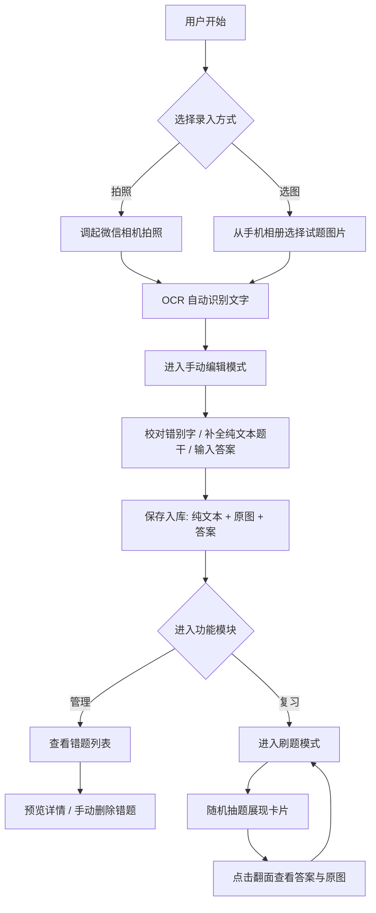

## 1. 需求背景

传统错题整理耗时且繁琐，复习效率低下。为了解决这一痛点，本产品定位为一款基于微信小程序形态的极简个人错题管理与智能刷题工具。产品主要面向 K12/中高考学生及家长，以及考研、公考等各类职业资格考试的备考人群。初期聚焦于“高效录入 - 结构化存储 - 针对性刷题”的极简闭环，后期将结合 AI 与算法打造个性化学习工具。

## 2. MVP 最小可行功能点（核心极简闭环）

MVP 阶段专注于跑通“录入-编辑-存储-复习”的核心流程，坚决不引入富文本排版、复杂数学公式渲染或图文混排，强制要求题干为纯文本格式。

- **题目采集与识别**：支持调起微信相机拍照或从手机相册选图。自动调起 OCR 服务识别图片中的文字作为题干，只识文字，不进行自动分类。
- **内容校对与完善**：提供文本编辑模式，支持用户手动修改识别出的错别字并补充题干信息。
- **极简错题入库**：保存错题记录，数据维度仅包含纯文本题目、原图地址、答案。
- **基础题库管理**：以卡片形式分页展示已录入的错题，支持快速预览题干与原图，并支持手动删除记录。
- **随机刷题复习**：提供随机抽取库中错题进行卡片式答题的功能，默认遮挡答案，点击后翻面显示答案与原图。

## 3. 后续可以做的扩展功能点（按优先级排序）

在 MVP 验证成功后，产品将向智能化与精细化方向演进。

- **[优先级：高] 账号与订阅管理**：支持微信一键登录，建立用户系统以保存同步数据，并管理会员订阅状态及高级权益。
- **[优先级：高] 题目多维分类**：支持按学科（如数学、英语）和自定义标签（如知识点、题型）对错题进行归纳与筛选。
- **[优先级：中] 学习数据与掌握度标记**：刷题时可手动标记“已掌握”或“熟练度等级”，记录刷题历史，生成正确率统计与复习热力图看板。
- **[优先级：中] 科学复习引擎**：基于艾宾浩斯遗忘曲线算法，动态计算题目最佳复习时间点，智能推送每日待复习题目。
- **[优先级：低] AI 变式题生成**：利用大语言模型（LLM）基于原错题题干，一键生成同类知识点的变式题及详细解析。
- **[优先级：低] 知识库题目生成**：支持用户上传外部文档或输入讲义文本，由 AI 自动提取解析并结构化生成练习题目。

## 4. 用户操作的具体流程图

## 5. 需求功能核题清单（MVP 阶段开发 Task 列表）

- [ ] **前端界面 - 首页与录入入口**：实现拍照/相册选图按钮交互，调起微信原生接口。
- [ ] **接口对接 - OCR 识别服务**：接入 OCR 接口，实现图片转纯文本题干。
- [ ] **前端界面 - 文本编辑页**：实现识别结果展示及可编辑文本框，支持输入题目和答案。
- [ ] **后端服务 - 错题存储接口**：实现错题保存逻辑，接收并存储题目（纯文本）、原图 URL、答案信息。
- [ ] **前端界面 - 题库列表页**：实现错题数据的卡片式分页展示及原图/详情预览。
- [ ] **后端服务 - 删除接口**：实现指定错题记录的物理/逻辑删除功能。
- [ ] **前端界面 - 刷题复习页**：实现随机抽题的交互逻辑，完成默认遮挡、点击卡片翻面显示答案和原图的动画/交互流。
