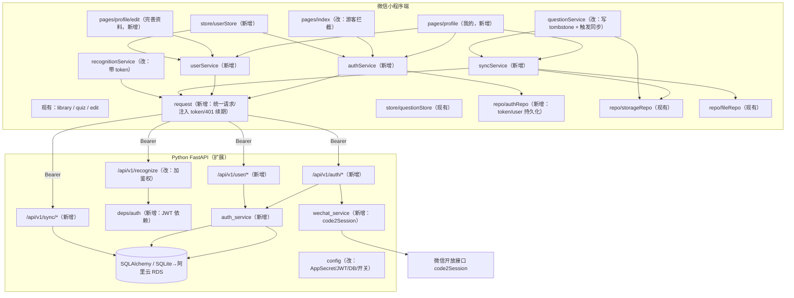

# 增量 Spec · 用户系统及用户相关功能

- 增量编号：**incr-20261014-用户系统**
- 日期：2026-10-14
- 流程：**/spec（高风险增量）** — 独立归档，**不修改主 spec**
- 关联文档：
  - 研讨记录：`./研讨记录.md`
  - 骨架原型：`./prototype/skeleton/用户系统原型-骨架.html`
  - 视觉原型：`./prototype/visual/用户系统原型-视觉.html`
  - 主基线：`.trae/specs/mvp-reverse-docs/spec.md`（只读参考）
- 任务拆分：`./tasks.md`　|　验收清单：`./checklist.md`

---

## 1. 目标与范围

为现「纯本地、无账号」的错题本小程序补齐**用户体系**，并打通「本地 → 云端」的第一次架构升级。

**范围内**：微信一键登录、退出登录、注销账号、完善资料（头像/昵称）、「我的」Tab 页、登录后自动云同步（**仅文本**）、识别接口补鉴权、游客模式（仅拍照识别需登录）。

**范围外**：会员/订阅、错题图片上云、密码/手机号登录、多账号、管理后台、推送。

> 完整口径见 `研讨记录.md` §2。本文只描述**技术方案**。

---

## 2. 总体架构



**核心数据策略（性价比方案）**：读路径仍走本地（`storageRepo` 不变）；写路径本地为准，登录态下异步镜像到云端；登录后自动 `push 本地 + pull 云端` 并按 `updatedAt` 新者优先合并。未来切「云优先」时仅替换 `repo` 层实现。

---

## 3. 数据模型

### 3.1 后端表（新增，SQLAlchemy ORM）

**`users`**

| 字段 | 类型 | 约束 | 说明 |
| --- | --- | --- | --- |
| `id` | Integer | PK, autoincrement | 内部主键 |
| `openid` | String(64) | **unique**, index, not null | 微信 openid |
| `unionid` | String(64) | nullable | 绑定开放平台后返回 |
| `nickname` | String(32) | nullable | 用户主动填写 |
| `avatar_url` | String(255) | nullable | 头像可访问 URL |
| `created_at` | BigInteger | not null | 毫秒时间戳 |
| `updated_at` | BigInteger | not null | 毫秒时间戳 |
| `last_login_at` | BigInteger | not null | 毫秒时间戳 |

**`question_sync`**（错题同步表，仅文本）

| 字段 | 类型 | 约束 | 说明 |
| --- | --- | --- | --- |
| `id` | Integer | PK, autoincrement | 内部主键 |
| `user_id` | Integer | FK `users.id`, index, not null | 归属用户 |
| `item_id` | String(32) | not null | 前端 `Question.id` |
| `content` | Text | not null | 题干 |
| `answer` | Text | not null, default '' | 答案 |
| `created_at` | BigInteger | not null | 与前端一致（ms） |
| `updated_at` | BigInteger | not null | 与前端一致（ms），冲突判定依据 |
| `deleted` | Boolean | not null, default false | 逻辑删除标记（墓碑） |
| `synced_at` | BigInteger | not null | 服务端写入时间（ms） |

- 唯一约束：`UniqueConstraint(user_id, item_id)`
- 索引：`Index(user_id, updated_at)`

### 3.2 前端本地存储键（新增）

| Key | 类型 | 内容 | 说明 |
| --- | --- | --- | --- |
| `u:auth` | `AuthSession \| null` | `{ accessToken, refreshToken, accessExpireAt, user }` | 登录态持久化 |
| `q:removed` | `Tombstone[]` | `{ id, updatedAt }[]` | 本地删除墓碑，供同步删除云端 |
| `q:syncCursor` | `number` | 上次同步服务端时间（ms） | 增量拉取游标 |

> 现有 `q:list` / `q:meta` / `q:schema` 结构**不变**。

### 3.3 前端数据类型

- **`Question` 结构不变**（不追加字段）。同步所需的 `updatedAt` 字段已存在；删除通过独立墓碑键表达。→ **降低数据模型风险**。
- 新增类型（`types/user.ts`）：

```ts
export interface UserProfile {
  id: number
  openid: string
  nickname: string | null
  avatarUrl: string | null
}
export interface AuthSession {
  accessToken: string
  refreshToken: string
  accessExpireAt: number  // ms
  user: UserProfile
}
export interface SyncItem {
  id: string
  content: string
  answer: string
  createdAt: number
  updatedAt: number
  deleted: boolean
}
export interface Tombstone { id: string; updatedAt: number }
```

### 3.4 schemaVersion

保持 `SCHEMA_VERSION = 1`：本次**不改动** `q:list` 内既有字段语义，新增键为独立命名空间，向后兼容，无需迁移（与现状「无迁移逻辑」一致）。

---

## 4. 接口契约

### 4.1 统一响应与错误码

新增接口统一信封（与现有 `RecognizeResponse` 扁平风格不同，此处采用信封以承载多类返回）：

```json
{ "code": 0, "message": "ok", "data": { } }
```

| code | 含义 | 触发 |
| --- | --- | --- |
| 0 | 成功 | — |
| 2001 | 未登录 / 缺少 token | 请求头无 `Authorization` |
| 2002 | 登录态失效 | access 过期且 refresh 不可用 |
| 2003 | 服务端未配置微信登录 | 缺 `WECHAT_APP_SECRET` |
| 2004 | 微信 code 无效 | `code2Session` 返回 errcode≠0 |
| 2005 | 参数校验失败 | 字段缺失/超长 |
| 2006 | 头像文件无效或过大 | 非图片 / 超 `AVATAR_MAX_BYTES` |
| 3001 | 同步数据格式错误 | `items` 结构非法 |

> HTTP 状态码：业务失败仍返回 **HTTP 200 + code**（与现有识别接口一致）；鉴权失败返回 **HTTP 401 + code 2002**（便于前端统一续期）。

### 4.2 接口明细

| 方法 | 路径 | 鉴权 | 请求 | 响应 `data` |
| --- | --- | --- | --- | --- |
| POST | `/api/v1/auth/login` | 否 | `{ code: string }` | `{ accessToken, refreshToken, accessExpireAt, user }` |
| POST | `/api/v1/auth/refresh` | 否 | `{ refreshToken }` | `{ accessToken, refreshToken, accessExpireAt, user }` |
| GET | `/api/v1/user/me` | 是 | — | `{ user }` |
| PATCH | `/api/v1/user/me` | 是 | `{ nickname? }` | `{ user }` |
| POST | `/api/v1/user/avatar` | 是 | multipart `file` | `{ user }` |
| POST | `/api/v1/user/delete` | 是 | — | `{ deleted: true }` |
| POST | `/api/v1/sync/push` | 是 | `{ items: SyncItem[], cursor?: number }` | `{ accepted: string[], serverTime }` |
| GET | `/api/v1/sync/pull` | 是 | `?since=<ms>` | `{ items: SyncItem[], serverTime }` |
| POST | `/api/v1/recognize` | **是（本次新增）** | multipart `file` | 维持现有 `RecognizeResponse` |

### 4.3 鉴权设计

- **算法**：JWT HS256，密钥来自 `JWT_SECRET`（env，不入库不入日志）。
- **有效期**：access `2h`（`JWT_ACCESS_TTL=7200`）；refresh `30d`（`JWT_REFRESH_TTL=2592000`）。
- **载荷**：`{ sub: user_id, iat, exp, typ: 'access'|'refresh' }`。
- **前端 `request` 封装**：自动注入 `Authorization: Bearer <access>`；命中 401/2002 时用 refresh 换新 token 并**重试一次**，失败则清登录态并跳「我的」未登录态。
- **识别接口鉴权**：走同一 `deps/auth`；受 `AUTH_REQUIRED` 开关控制（默认 `true`），可在紧急回滚时置 `false` 恢复旧行为。

### 4.4 头像上传（范围界定）

- 头像属**用户资料**，需持久化，故**单独上云**（与「错题原图不上云」不冲突，为**唯一**上云图片）。
- 接口：`POST /api/v1/user/avatar`（multipart，≤ `AVATAR_MAX_BYTES=2MB`），后端存 `server/uploads/avatars/{user_id}.{ext}`，静态挂载 `/static/avatars/`，DB 存相对 URL。
- 前端：`chooseAvatar` 得到临时路径 → 上传 → 返回 `avatarUrl` → 更新本地 `u:auth.user`。
- 降级：上传失败保留原头像，Toast 提示，不阻断。

---

## 5. 同步策略

### 5.1 触发时机

| 时机 | 行为 |
| --- | --- |
| 登录成功 | 立即执行一次完整同步（push 本地全量 + pull 自 `cursor` 起增量） |
| App 启动（已登录） | 后台静默同步一次 |
| 本地写入（新增/删除错题）且已登录 | 异步 push 变更（节流 3s），失败静默重试 |
| 手动 | **无**（不设同步 UI） |

### 5.2 合并算法（新者优先）

```
对每个云端 item：
  local = 本地按 id 查找
  若 local 不存在        → 插入本地（无原图）
  若 remote.deleted      → 删除本地该项（含原图）
  若 remote.updatedAt > local.updatedAt → 覆盖本地文本字段
  否则                    → 保留本地
```

push 端：服务端 `UPSERT (user_id,item_id)`，仅当 `incoming.updatedAt > stored.updatedAt` 才覆盖。

### 5.3 删除与墓碑

- 前端删除错题时（`questionService.remove`）：本地删除 + 写入 `q:removed` 墓碑 `{id, updatedAt: Date.now()}`。
- push 时墓碑转成 `deleted: true` 的 `SyncItem` 上行；pull 到 `deleted` 项时本地删除并清理墓碑。
- 墓碑保留上限：合并完成后清理已同步墓碑，避免无限增长。

### 5.4 失败降级

- 同步失败**不影响**本地使用；仅 `console.error` 记录 + 静默重试（下次启动/写入再试）。
- 网络不可用（如未配置 HTTPS 合法域名的真机环境）：登录/同步均失败 → 应用保持游客态可用。

### 5.5 图片边界（明示）

- 错题原图**不上云**；从其他设备拉回的错题 `imagePath` 为空，题库详情页「原图」区块**不展示**（现有 UI 已按有/无图分支处理）。
- 仅在文案上向用户明示「换设备后可刷题，但无原图」——**该提示放在编辑/详情页的合适位置由实现评估，不得侵入原型界面**。

---

## 6. 前端设计

### 6.1 新增模块

| 文件 | 职责 |
| --- | --- |
| `src/services/request.ts` | 统一请求：baseURL、超时、注入 token、401 自动续期重试、错误码映射 |
| `src/services/authService.ts` | `login()`（`Taro.login`→`/auth/login`）、`refresh()`、`logout()`、`restore()` |
| `src/services/userService.ts` | `me()`、`updateNickname()`、`updateAvatar(tempPath)` |
| `src/services/syncService.ts` | `pushLocal()`、`pullRemote()`、`syncNow()`、`scheduleSync()`（节流） |
| `src/services/repo/authRepo.ts` | `u:auth` 读写；`q:removed` / `q:syncCursor` 读写 |
| `src/store/userStore.ts` | Zustand：`user`、`isLoggedIn`、`login/logout/refreshUser/updateProfile` |
| `src/pages/profile/index.tsx` + `.config.ts` + `.module.scss` | 「我的」页（未登录/已登录两态） |
| `src/pages/profile/edit/index.tsx` + `.config.ts` + `.module.scss` | 完善资料页 |
| `src/components/LoginSheet/`（`index.tsx` + `.module.scss`） | 登录引导底部弹层（新增组件，复用 ActionSheet 面板样式；不改动 ActionSheet 本身） |
| `src/types/user.ts` | 用户/同步类型 |

### 6.2 修改模块（含行为差异）

| 文件 | 改动 | 行为差异 |
| --- | --- | --- |
| `src/app.config.ts` | 注册两个新页面；tabBar 增加「我的」 | tabBar 3 → 4 项 |
| `src/constants/index.ts` | 新增 `STORAGE_KEYS.auth/removed/syncCursor`、`API_BASE`（沿用现有 `RECOGNIZE_API_BASE`）、用户域错误码文案、`AVATAR_MAX_BYTES` | 无破坏性 |
| `src/services/recognitionService.ts` | 请求头带 token | 游客调用将收到 401 → 上层拦截（见下） |
| `src/services/questionService.ts` | `remove` 写墓碑；`create/remove` 后触发 `syncService.scheduleSync()` | 本地行为不变，新增异步副作用 |
| `src/app.tsx` | 启动恢复登录态；已登录则后台同步 | 新增启动副作用 |
| `src/pages/index/index.tsx` | 「拍照录入」入口做登录校验 | **游客**点击 → 弹 `LoginSheet`；已登录 → 原流程 |
| `src/assets/tabbar/` | 新增 `profile.png` / `profile-selected.png`（81×81） | 新增 2 个资源 |

**游客拦截逻辑**：仅「拍照录入」入口拦截；题库/刷题/编辑页**手动**录入对游客开放。

### 6.3 页面与交互

严格按已确认的视觉原型实现：`我的`（未登录/已登录）、`完善资料`、`LoginSheet`、`ConfirmDialog`（复用现有组件做注销二次确认）。视觉令牌与组件复用关系见视觉原型「设计说明」。

---

## 7. 后端设计

### 7.1 目录结构（新增/修改）

```
server/app/
├── db/
│   ├── __init__.py
│   ├── base.py          # Declarative Base
│   └── session.py       # engine / SessionLocal / get_db 依赖 / init_db()
├── models/
│   ├── __init__.py
│   ├── schemas.py       （现有，追加用户/同步 Pydantic 模型）
│   ├── user.py          # User ORM
│   └── question_sync.py # QuestionSync ORM
├── deps/
│   ├── __init__.py
│   └── auth.py          # get_current_user（Bearer → JWT → User）
├── services/
│   ├── wechat_service.py  # code2Session 封装（httpx）
│   ├── auth_service.py    # 用户创建/查询、JWT 签发与校验
│   └── vision_recognize.py（现有，不改）
├── api/
│   ├── auth.py          # login / refresh
│   ├── user.py          # me / avatar / delete
│   ├── sync.py          # push / pull
│   └── recognize.py     （改：加鉴权依赖）
├── config.py            （改：新增配置）
└── main.py              （改：装配 DB、静态目录、新路由）
```

### 7.2 配置项（新增）

| 环境变量 | 默认值 | 说明 |
| --- | --- | --- |
| `WECHAT_APPID` | `wxf7fbaf8d9a6f7296` | 小程序 AppID（非密） |
| `WECHAT_APP_SECRET` | `""` | **密**，`repr=False`；缺失时登录返回 2003 |
| `JWT_SECRET` | `""` | **密**，`repr=False`；缺失时启动告警 |
| `JWT_ACCESS_TTL` | `7200` | access 秒 |
| `JWT_REFRESH_TTL` | `2592000` | refresh 秒 |
| `DATABASE_URL` | `sqlite:///./app.db` | 上线切阿里云 RDS 连接串 |
| `AUTH_REQUIRED` | `true` | 识别接口是否强制鉴权（回滚开关） |
| `AVATAR_MAX_BYTES` | `2097152` | 头像上限 2MB |

### 7.3 依赖（`requirements.txt` 追加）

```
SQLAlchemy>=2.0,<3.0
PyJWT>=2.8,<3.0
```

> 沿用现有 `httpx` 调 `code2Session`；沿用现有「缺失密钥不抛错、调用时才报错」的配置风格。

---

## 8. 安全与合规

| 项 | 措施 |
| --- | --- |
| 密钥 | AppSecret / JWT_SECRET 仅后端 env，`repr=False`，不下发前端、不入日志 |
| CORS | 由 `allow_origins=["*"]` 收敛为**白名单**（开发期保留放开，通过 env 控制） |
| 越权 | 所有 user/sync 接口按 `user_id` 过滤；`item_id` 唯一约束限用户内 |
| 注销 | 删除 `users` 记录 + 其全部 `question_sync`；前端清 `u:auth`/`q:list`/`q:meta`/`q:removed`/`q:syncCursor` + 全部本地图片 |
| 隐私 | 需在小程序后台配置《用户隐私保护指引》，声明「头像昵称」与「登录」；列为上线前置项 |

---

## 9. 兼容、灰度与回滚

| 场景 | 方案 |
| --- | --- |
| 老数据兼容 | `q:list` 结构不变；新键独立；无迁移 |
| 未配置 AppSecret | 登录返回 2003，前端提示「登录暂不可用」，游客链路完整可用 |
| 网络不可用 | 保持游客态；所有既有功能不受影响 |
| 识别接口回滚 | `AUTH_REQUIRED=false` 即可恢复旧的无鉴权行为 |
| 后端整体回滚 | 新路由/新模块独立，移除装配即回到纯识别代理 |
| 前端回滚 | tabBar 与页面为纯追加；`app.config.ts` 回退即恢复 |
| 灰度 | 无（单实例开发期）；上线如需灰度可先仅对内部白名单 openid 放开登录 |

---

## 10. 非目标（Out of Scope）

见 `研讨记录.md` §2.3。摘要：会员/订阅/支付、错题图片上云、密码/手机号登录、多账号、管理后台、推送/复习引擎、修改主 spec、前端自动化测试补齐。

---

## 11. 验收标准

1. 未登录可完整使用：首页、题库、刷题、编辑页**手动**录入均正常。
2. 游客点「拍照录入」→ 弹 `LoginSheet`，含「暂不登录」，取消后停留原页且其他操作不受阻。
3. 登录成功后「我的」切已登录态，头像/昵称正确展示；`q:list` 自动上传云端。
4. 完善资料可改头像与昵称并持久化；换设备登录后昵称/头像恢复（错题文本恢复、无原图）。
5. 退出登录：清登录态、**保留**本地错题，回到未登录态。
6. 注销账号：二次确认 → 云端与本地数据全部清除 → 回到初始态。
7. 识别接口在未登录时不可用，登录后恢复正常识别。
8. 同步遵循 `updatedAt` 新者优先；删除可通过墓碑同步到其他设备。
9. 既有 MVP 功能无回归（见 `checklist.md` 回归项）。
10. 后端新增单测通过（`pytest`）。

---

## 12. 待确认项（进入编码前）

1. **头像上云**为本次唯一的图片上云（用户资料，非错题原图）——是否认可？
2. `DATABASE_URL` 开发期使用 `sqlite:///./app.db`，上线切阿里云 RDS 连接串——是否认可该切换方式？
3. 错误码域划分（用户域 2xxx / 同步域 3xxx）是否认可？
