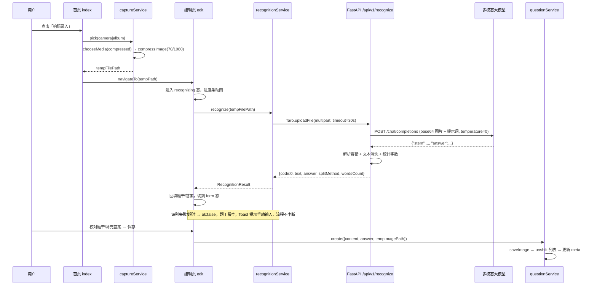
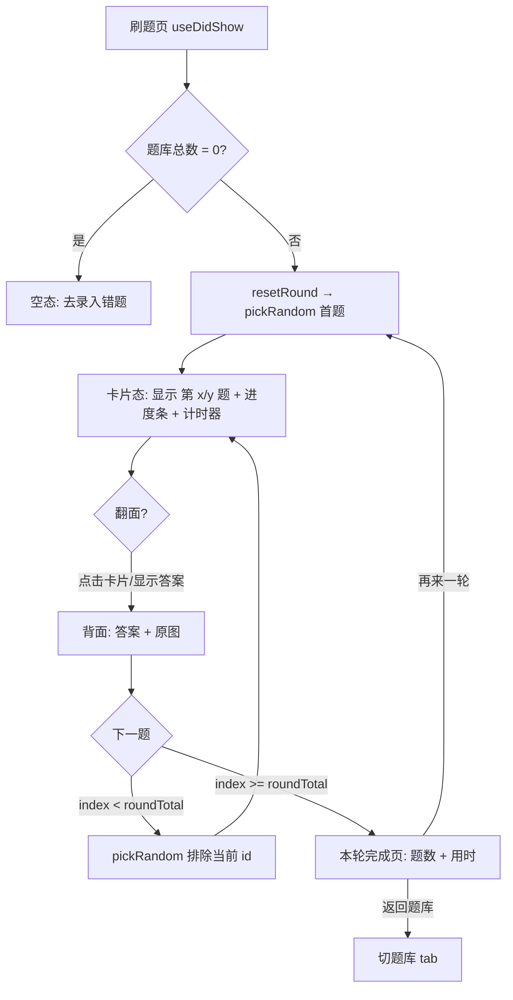
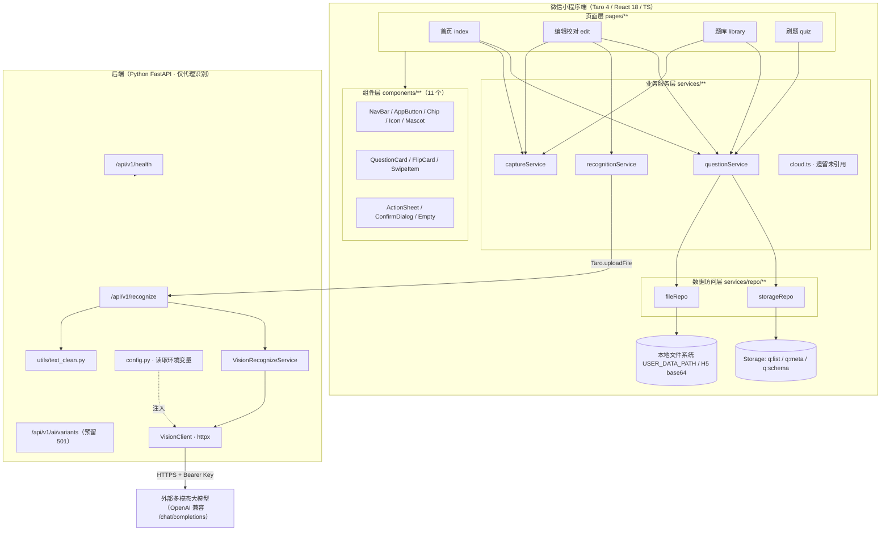
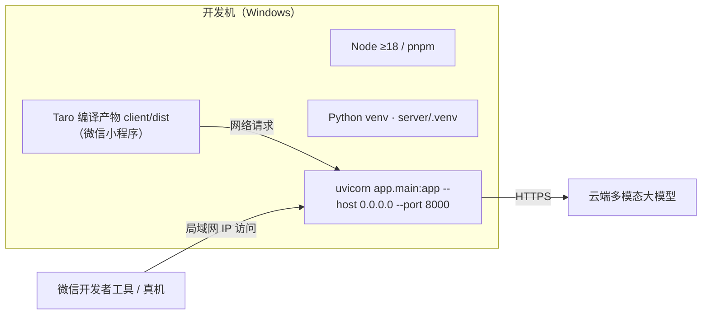
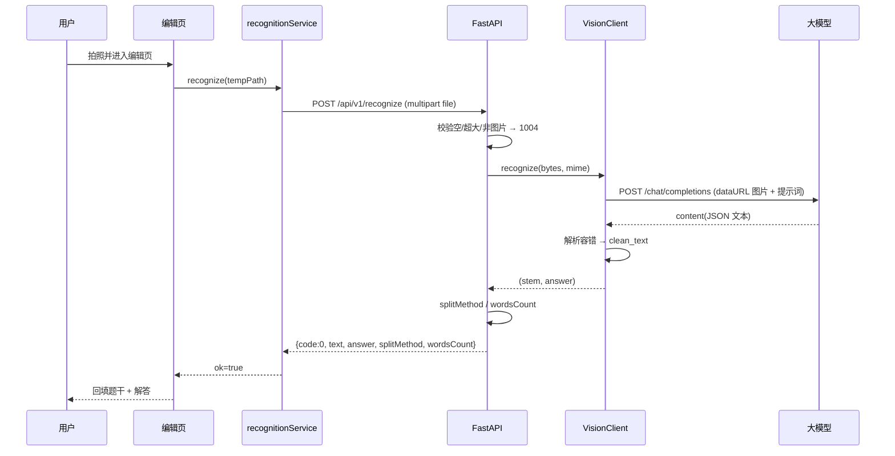

# 错题本小程序 MVP · 逆向项目文档（Spec）

> 文档性质：**逆向分析文档**。基于仓库现有可运行代码与既有设计文档，反推真实实现。
> 硬性口径：**只描述代码中已经存在的实现，不脑补、不虚构功能**；与原始设计文档不一致处，以**代码为准**并显式标注差异。
> 输出目录：`.trae/specs/mvp-reverse-docs/`
> 本次目标：仅完成文档沉淀，**不修改/新增任何源码，不执行任何开发任务**。

---

## 1. 项目概述

### 1.1 产品定位

一款基于**微信小程序**的极简**个人错题管理与随机刷题工具**，跑通"拍照/选图 → 多模态识别 → 人工校对 → 本地入库 → 卡片题库 → 随机抽题翻面复习"的核心闭环。题干强制为**纯文本**，不做富文本、公式渲染、图文混排。

### 1.2 目标用户

K12/中高考学生及家长，以及考研、公考等职业资格考试备考人群（引自 `.docs/需求分析文档.md`）。

### 1.3 仓库结构（真实落盘）

```text
ai-error-learn/
├── .docs/                         # 需求分析 / 方案设计 / UI 原型设计（历史设计文档）
├── .trae/
│   ├── documents/                 # 开发过程中的 16 份专题方案/修复记录
│   └── skills/                    # ui-ux-pro-max 技能数据（与本项目业务无关）
├── client/                        # 前端：Taro 4 + React 18 + TypeScript（微信小程序）
│   ├── config/                    # Taro 编译配置（index/dev/prod）
│   ├── src/
│   │   ├── pages/{index,edit,library,quiz}/   # 4 个页面
│   │   ├── components/            # 11 个自研通用组件
│   │   ├── services/              # 业务服务 + repo 数据访问层 + cloud(遗留)
│   │   ├── store/                 # Zustand 全局状态
│   │   ├── constants/             # 存储 Key / 分页 / 后端地址 / 错误码 / 图标 / 吉祥物
│   │   ├── types/                 # 数据模型类型
│   │   ├── utils/                 # id / format / layout / platform
│   │   └── styles/                # 设计令牌（theme/variables/compat）
│   └── project.config.json 等     # 微信小程序工程配置
├── server/                        # 后端：Python FastAPI（仅识别密钥代理）
│   ├── app/{api,models,services,utils,config.py,main.py}
│   └── tests/                     # 后端单元测试（pytest）
├── deepseek-design/               # 采用的 UI 原型（3 个 HTML，v3 轻盈化）
└── glm-design/                    # 弃用原型（历史）
```

### 1.4 技术栈（代码实证）

| 层 | 技术 | 依据 |
| --- | --- | --- |
| 前端框架 | Taro 4.1.9 + React 18 + TypeScript 5 | `client/package.json` |
| 样式 | SCSS + CSS Modules（`*.module.scss`）+ 设计令牌 | `client/config/index.ts`、`client/src/styles/*` |
| 状态管理 | Zustand 4 | `client/src/store/questionStore.ts` |
| 工具库 | classnames、dayjs | `client/package.json` |
| 前端目标端 | 仅 `weapp`（H5 作为预览降级） | `client/src/utils/platform.ts` |
| 后端框架 | FastAPI + Uvicorn + Pydantic v2 | `server/app/main.py`、`server/requirements.txt` |
| 后端 HTTP 客户端 | httpx（直连，无常规模块） | `server/app/services/vision_recognize.py` |
| 识别能力 | OpenAI 兼容多模态大模型（测试期 GLM-4V-Flash，上线切 Qwen-VL-Flash） | `server/app/config.py`、`.env.example` |
| 后端测试 | pytest + FastAPI TestClient | `server/tests/*`、`server/pytest.ini` |

### 1.5 当前状态

- 代码**可运行**，MVP 核心闭环已落地（`client` + `server` 双工程）。
- 后端存在完整 TDD 单测（5 个测试文件）；**前端无自动化测试**。
- AI 变式题能力**仅预留接口**（`/api/v1/ai/variants` 固定返回 501）。
- 无用户体系、无业务数据库、无云端同步；数据 100% 留存用户本地。

---

## 2. 重要说明：代码与历史设计文档的差异（务必以代码为准）

逆向过程中发现仓库中的 `.docs/方案设计文档.md`、`.trae/documents/错题本MVP开发计划.md` 与**实际代码**存在演进差异。以下为**代码真实状态**：

| 主题 | 历史文档描述 | 代码真实实现 |
| --- | --- | --- |
| 识别服务 | 微信云函数代理**阿里云文字识别 OCR**（`/api/v1/ocr`） | Python FastAPI 代理**多模态视觉大模型**（OpenAI 兼容 `/chat/completions`），接口为 `/api/v1/recognize` |
| 识别产物 | 仅题干文本，答案由"规则+LLM"二次分离 | **一步**识别出「题干 + 解答（含解题过程）」，`splitMethod` 仅 `vlm`/`none` |
| 云函数 | `cloudfunctions/ocr/` | 目录**不存在**；`client/src/services/cloud.ts` 为模板遗留文件，**未被任何代码引用** |
| 前端服务命名 | `ocrService` | 已重命名为 `recognitionService`（`OCR` 相关命名统一为"识别"） |
| 前端状态 | store 维护列表/总数/加载态 | store 仅维护 `total` 与 `refresh` |
| 后端地址 | 可用 `TARO_APP_OCR_API_BASE` 环境变量覆盖 | **硬编码局域网 IP** `http://192.168.60.37:8000`，无环境变量覆盖 |
| 图片上云降级 | 预留"图片上云存储"开关 | **未实现**，仅有本地文件系统实现 |
| 容量超限提示 | 保存前校验剩余容量并提示 | **未实现**，仅统计 `imageBytes` 元数据，无阈值告警 |
| 手动"拆分答案"按钮 | 编辑页提供兜底按钮 | **未实现**，答案仅来自模型识别或手动输入 |

> 本文件后续所有描述均基于**右侧（代码真实实现）**。

---

## 3. 业务流程

### 3.1 主流程总览

```mermaid
graph TD
    A([打开小程序]) --> B[首页: 错题总数 + 拍照录入 / 开始刷题]
    B -->|拍照录入| C{ActionSheet 选择}
    C -->|拍照| D[相机]
    C -->|从相册选择| E[相册]
    D --> F[图片压缩 quality=70, width=1080]
    E --> F
    F --> G["跳转编辑页并携带 tempPath"]
    G --> H[编辑页自动进入「识别中」：上传后端"]
    H --> I{识别结果}
    I -->|成功| J[回填题干 + 解答, splitMethod=vlm/none]
    I -->|失败| K[题干为空 + Toast 提示手动输入]
    J --> L[「编辑校对」页：可改题干预览原图]
    K --> L
    L -->|重拍| C
    L -->|保存入库| M[题干非空校验 → 落图片 + 写 q:list/q:meta]
    M --> N[Toast 已保存 → 切到题库页]
    B -->|开始刷题| O[刷题页]
    O --> P[随机抽题 · 正面遮挡答案]
    P --> Q[点击卡片/按钮 3D 翻面 → 答案 + 原图]
    Q --> R{还有下一题?}
    R -->|是| P
    R -->|否| S[本轮完成页: 题数 + 用时]
    N --> T[题库: 卡片列表/分页/详情/删除]
```

### 3.2 录入与识别闭环（时序）



### 3.3 题库管理流程

```mermaid
graph TD
    A[题库页 useDidShow] --> B[reload: 读第 1 页 + 总数, 同步 store]
    B --> C{有数据?}
    C -->|无| D[空态: 去录入第一道错题]
    C -->|有| E[卡片列表 SwipeItem + QuestionCard]
    E -->|点击卡片| F[详情视图: 隐藏 tabBar, 题干/原图/答案]
    E -->|左滑| G[露出删除按钮]
    E -->|长按| H[二次确认弹窗]
    F -->|删除本题| H
    G -->|删除| H
    H -->|确认| I[remove: 删除列表项 + 删原图 + 回写 meta/reload]
    H -->|取消| E
    E -->|触底| J{已加载 < 总数?}
    J -->|是| K[page+1, 追加下一页(每页 10)]
    J -->|否| E
    E -->|FAB +| L[ActionSheet 拍照/相册 → 编辑页]
```

### 3.4 刷题复习流程



### 3.5 启动清理流程

```mermaid
graph TD
    A[App useEffect 启动] --> B[读取 q:list 中的 imagePath 集合]
    B --> C[fileRepo.clearOrphans(validPaths)]
    C --> D[扫描本地图片: weapp 文件系统 / H5 Storage]
    D --> E[删除不在有效集合中的无主图片]
```

---

## 4. 系统架构

### 4.1 整体架构



### 4.2 分层职责

| 层 | 目录 | 职责 | 约束 |
| --- | --- | --- | --- |
| 页面层 | `client/src/pages/**` | 渲染与交互编排，调用服务层 | 不直接操作 Storage |
| 组件层 | `client/src/components/**` | 受控/无状态通用 UI 组件 | 不感知业务存储 |
| 业务服务层 | `client/src/services/*.ts` | 编排录入、识别、入库、抽题 | 仅通过 repo 访问存储 |
| 数据访问层 | `client/src/services/repo/**` | 封装 Storage 与文件系统读写 | 对外暴露 CRUD，屏蔽端差异 |
| 状态层 | `client/src/store/questionStore.ts` | 跨页共享错题总数 | Zustand |
| 后端 API 层 | `server/app/api/**` | 路由与请求校验 | 通过依赖注入 service |
| 后端服务层 | `server/app/services/**` | 识别业务编排与错误码映射 | httpx 直连，client 可注入便于测试 |
| 后端配置层 | `server/app/config.py` | 环境变量装载，密钥不落盘/不入日志 | 缺失密钥不抛错，调用时才报错 |

> 分层核心收益（引自方案文档）：将"存储介质"与"业务逻辑"解耦，未来从"纯本地"升级为"云端账号同步"时只需替换 `repo` 层实现。

### 4.3 部署与运行方式



**关键部署事实（代码实证）：**

1. 前端 `RECOGNIZE_API_BASE` 硬编码为 `http://192.168.60.37:8000`（`client/src/constants/index.ts`），即**局域网 IP + 8000 端口**。
   - 微信小程序网络层**禁止**访问 `localhost/127.0.0.1`，模拟器与真机均须用局域网 IP；开发机 IP 变化时**必须改源码并重新编译**。
2. 后端启动：`uvicorn app.main:app --host 0.0.0.0 --port 8000`（`server/app/main.py` 文件头注释）。
3. 便捷脚本：`client/package.json` 提供 `npm run server`（校验后端依赖 + 启动 uvicorn，**Windows 专用**，依赖 `server/.venv` 与可选 `server/.env`）。
4. 编译目标：`build:weapp`（主）/ `build:h5`（预览降级）；另有 swan/alipay/tt/rn 等脚本但未使用。
5. 密钥注入：后端从环境变量或 `server/.env` 读取（`override=True`）；仓库仅提供 `.env.example`，**无真实 `.env`**。
6. 微信工程配置 `client/project.config.json`：`appid=wxf7fbaf8d9a6f7296`，`urlCheck=true`，声明了 `cloudfunctionRoot: cloudfunctions/`（目录实际不存在）。

---

## 5. 模块说明

### 5.1 前端页面（4 个）

| 页面 | 路径 | 核心职责 | 关键实现 |
| --- | --- | --- | --- |
| 首页 | `pages/index/index.tsx` | 品牌区 + 错题总数 + 两个主入口（拍照录入 / 开始刷题） | `useDidShow` 刷新 store；ActionSheet 选择拍照/相册 → 跳编辑页 |
| 编辑校对 | `pages/edit/index.tsx` | 识别进度的"识别中"态 + "编辑校对"表单，保存入库 | 两段式 `phase`；进度条动画（定时器 + 至少 700ms）；题干非空方可保存；保存成功 1.5s 后切题库 |
| 题库 | `pages/library/index.tsx` | 卡片分页列表 / 详情预览 / 左滑与长按删除 / FAB 录入 / 空态 | `useReachBottom` 分页（每页 10）；详情视图隐藏 tabBar；删除二次确认 |
| 刷题 | `pages/quiz/index.tsx` | 随机抽题 / 遮挡答案 / 3D 翻面 / 本轮完成页 | 4 个 phase（loading/card/empty/done）；计时器；`pickRandom` 排除当前题 |

### 5.2 前端通用组件（11 个，均 `index.tsx` + `index.module.scss`）

| 组件 | 职责 | 备注 |
| --- | --- | --- |
| `NavBar` | 自定义毛玻璃导航栏，微信端自动避让胶囊 | 支持返回/右文/右插槽 |
| `AppButton` | 胶囊主/次/文字/危险按钮 | `disabled`、`width`、`icon` |
| `Chip` | 圆角标签（green/blue/orange/neutral） | — |
| `Icon` | 线性图标，base64 SVG data URI 渲染 | 颜色固化在各 variant（`constants/icons.ts`） |
| `Mascot` | 卡通形象「小错题本」 | 3 变体 default/empty/done，浮动动画遵循 `prefers-reduced-motion` |
| `QuestionCard` | 列表卡片：题干 2 行截断 + 含原图角标 + 时间 | — |
| `FlipCard` | 纯 CSS 3D 翻面（perspective 1000px / rotateY 180° / 0.4s） | 受控 `flipped` |
| `SwipeItem` | 列表项左滑删除（左移 76px） | 受控 `open`，触摸手势 |
| `ActionSheet` | 底部弹层（毛玻璃），录入方式选择 | — |
| `ConfirmDialog` | 居中二次确认弹窗（删除） | — |
| `Empty` | 空态：吉祥物 + 主副文案 + 行动按钮 | 复用 `Mascot`、`AppButton` |

### 5.3 前端业务服务层

| 服务 | 职责 | 关键实现 |
| --- | --- | --- |
| `questionService` | 错题业务编排：新建/分页/全量/取单条/删除/随机抽题/计数 | 新建先落图片再写列表与 meta；`pickRandom` 用 **Fisher-Yates + 本轮已抽集合**，抽完一轮自动重置；删除同步清理图片与 meta |
| `recognitionService` | 识别流程编排 | `Taro.uploadFile` → `/api/v1/recognize`（timeout 30s）；失败/超时不阻断，返回 `{ok:false}` |
| `captureService` | 拍照/相册采集 + 压缩 | weapp：`chooseMedia`(compressed) + `compressImage`(quality 70, width 1080)；非 weapp：`chooseImage` |
| `cloud.ts` | **模板遗留** | 提供 `callFunction`/`getDatabase`，`Taro.cloud` 分支；**未被任何模块引用**，且引用的 `../data/${name}` 目录不存在 |

### 5.4 前端数据访问层（repo）

| 模块 | 职责 |
| --- | --- |
| `storageRepo` | 封装 Storage：`listQuestions`/`saveQuestions`/`getMeta`/`saveMeta`；读失败回退空数组/默认 meta |
| `fileRepo` | 封装图片：`saveImage`/`removeImage`/`calcUsage`/`clearOrphans`/`resolveImageSrc`/`getFileSize`。weapp 走文件系统，H5 走 base64 存 Storage，接口签名一致 |

### 5.5 前端状态 / 工具 / 常量

| 模块 | 内容 |
| --- | --- |
| `store/questionStore.ts` | Zustand：`total` + `refresh()`（仅总数，非列表） |
| `utils/id.ts` | `createId()`：时间戳(36进制) + 随机串 |
| `utils/format.ts` | `formatTime`（今天/昨天/日期）、`formatDuration`（m:ss）、`formatBytes`（**未被引用**） |
| `utils/layout.ts` | 导航栏布局计算、rpx→px（H5 换算）、页面最小高度、FAB 底部距离 |
| `utils/platform.ts` | 编译期端判定：`isWeapp`/`isH5`/`supportsFileSystem`（后者**未被引用**） |
| `constants/index.ts` | STORAGE_KEYS、SCHEMA_VERSION=1、PAGE_SIZE=10、`RECOGNIZE_API_BASE`、错误码文案、题干/答案最大长度 |
| `constants/icons.ts` / `mascot.ts` | 图标与吉祥物的 base64 SVG 资源 |

### 5.6 后端模块

| 模块 | 职责 |
| --- | --- |
| `app/main.py` | 应用装配：CORS（放开全部来源）、装配两个路由、`/api/v1/health`；构造 `VisionClient` + `VisionRecognizeService` |
| `app/config.py` | 从环境变量/`.env`（override=True）装载 `Settings`；密钥 `repr=False` 防泄露 |
| `app/api/recognize.py` | `POST /api/v1/recognize`：接收 multipart 图片，空/超大/非图片 → 1004；调用 service 并组装响应 |
| `app/api/ai.py` | `POST /api/v1/ai/variants`：固定返回 HTTP 501 / `code=9001` |
| `app/services/vision_recognize.py` | 核心识别：`VisionClient`（httpx 直连 OpenAI 兼容端点）+ `VisionRecognizeService`（编排）+ 输出解析容错 + 错误码映射 |
| `app/services/ai_service.py` | AI 预留：`VariantGenerator` Protocol + `DisabledVariantGenerator`（抛 `AiDisabledError`） |
| `app/models/schemas.py` | Pydantic 模型：`RecognizeResponse`、`AiResponse` |
| `app/utils/text_clean.py` | 纯函数：`clean_text`（统一换行/去空行/压缩空白）、`count_words`（忽略空白统计字数） |

---

## 6. 接口清单

### 6.1 后端 HTTP 接口（FastAPI，前缀 `/api/v1`）

| 方法 | 路径 | 请求 | 响应 | 说明 |
| --- | --- | --- | --- | --- |
| GET | `/api/v1/health` | — | `{"status":"ok"}` | 健康检查 |
| POST | `/api/v1/recognize` | `multipart/form-data`，字段 `file`（图片） | `RecognizeResponse`（见下） | 识别题干 + 解答 |
| POST | `/api/v1/ai/variants` | JSON（任意 body） | HTTP **501** `{"code":9001,"message":"AI 功能未启用"}` | 预留，未启用 |

**`RecognizeResponse` 字段**（`response_model_exclude_none=True`）：

| 字段 | 类型 | 说明 |
| --- | --- | --- |
| `code` | int | 0 成功；非 0 见错误码 |
| `text` | string | 识别出的题干 |
| `answer` | string | 识别出的解答（可为空） |
| `splitMethod` | string | `vlm`（有答案）/ `none`（无答案） |
| `wordsCount` | int | 题干有效字数（忽略空白） |
| `message` | string? | 失败时的提示文案（成功时省略） |

**后端错误码（返回 HTTP 200 + `code`）：**

| code | 含义 | 触发条件 |
| --- | --- | --- |
| 1002 | 识别失败 | 网络异常 / 5xx / 响应结构异常 / 未配置密钥 / 图片为空 |
| 1003 | 配额受限 | HTTP 429 或命中限流关键字（quota/throttle/rate limit…） |
| 1004 | 图片无效或过大 | 空文件 / 超过 `VISION_MAX_IMAGE_BYTES` / `content_type` 非 `image/*` |
| 1005 | 服务未开通或无权限 | HTTP 401/403 或命中鉴权关键字（unauthorized/forbidden…） |

### 6.2 前端本地服务接口（TypeScript，非 HTTP）

```ts
questionService.create(input: { content: string; answer: string; tempImagePath?: string }): Promise<Question>
questionService.list(page: number, size?: number): Question[]   // 默认 PAGE_SIZE=10
questionService.all(): Question[]
questionService.get(id: string): Question | undefined
questionService.remove(id: string): Promise<void>
questionService.pickRandom(excludeIds?: string[]): Question | undefined
questionService.resetRound(): void
questionService.roundDrawnCount(): number
questionService.count(): number

fileRepo.saveImage(tempPath: string, id: string): Promise<SavedImage>
fileRepo.removeImage(path?: string): void
fileRepo.calcUsage(): number
fileRepo.clearOrphans(validPaths: string[]): void
fileRepo.resolveImageSrc(path?: string): string
fileRepo.getFileSize(path?: string): number

storageRepo.listQuestions(): Question[]
storageRepo.saveQuestions(list: Question[]): void
storageRepo.getMeta(): AppMeta
storageRepo.saveMeta(meta: AppMeta): void
```

### 6.3 识别结果解析容错策略（`vision_recognize._parse_content`）

依次尝试：`json` 代码块围栏提取 → 截取首个 `{...}` → `json.loads(strict=False)`（容忍未转义换行）。解析失败时**整段文本作为题干、答案置空**（容错优先，不抛错）。

---

## 7. 数据模型与存储结构

### 7.1 关键结论：MVP **无数据库**

本 MVP **不包含任何服务端业务数据库**（无 MySQL/PostgreSQL/MongoDB/Redis 等），后端仅做识别密钥代理，**不落库、不存业务数据**。全部错题数据存于**用户设备本地**：

- `Storage`（Key-Value）：题干、答案、元数据、索引；
- 本地文件系统 `USER_DATA_PATH`：压缩后的原图（H5 降级为 Storage 中的 base64）。

因此下文以"**存储结构**"等价描述传统"数据库表结构"。

### 7.2 本地存储键（等价"表"）

| 存储 Key | 类型 | 内容 | 读写策略 |
| --- | --- | --- | --- |
| `q:list` | `Question[]` | 主数据，内存中按 `createdAt` 倒序 | 列表页同步读；写入同步覆盖 |
| `q:meta` | `AppMeta` | 应用元数据 | 同步读 |
| `q:schema` | `number` | 当前 `schemaVersion`（=1） | 随 meta 写入 |

> `q:img:{id}`（H5 降级专用）：图片以 base64 dataURL 存于 Storage。

### 7.3 实体：Question（`q:list` 中的元素）

| 字段 | 类型 | 必填 | 说明 |
| --- | --- | --- | --- |
| `id` | string | 是 | 唯一 ID：时间戳(36进制) + 6 位随机串 |
| `content` | string | 是 | 纯文本题干（保存前 `trim`，最大 200 字） |
| `answer` | string | 是 | 答案/解题过程（可空串，最大 600 字） |
| `imagePath` | string? | 否 | weapp 为 `wxfile://` 本地路径；H5 为 Storage Key |
| `imageSize` | number? | 否 | 图片字节数（容量统计用；为 0 时不写入） |
| `createdAt` | number | 是 | 创建时间戳（ms） |
| `updatedAt` | number | 是 | 更新时间戳（ms）；**当前仅在创建时赋值，编辑场景未使用** |

### 7.4 实体：AppMeta（`q:meta`）

| 字段 | 类型 | 说明 |
| --- | --- | --- |
| `schemaVersion` | number | 数据结构版本（当前 1，仅写入，**无迁移逻辑**） |
| `imageBytes` | number | 本地图片累计占用（字节） |
| `questionCount` | number | 题目总数（冗余缓存） |

### 7.5 图片文件命名与生命周期

| 阶段 | 行为 | 位置 |
| --- | --- | --- |
| 命名 | weapp：`${USER_DATA_PATH}/q_{id}.jpg`；H5：Storage Key `q:img:{id}` | `fileRepo` |
| 创建 | 保存错题时 `saveImage(tempPath, id)` 落盘/入库 | `questionService.create` |
| 删除 | 删除错题时同步删除原图，并回写 `q:meta.imageBytes` | `questionService.remove` |
| 孤儿清理 | 启动时比对 `q:list` 的 `imagePath` 与本地实际文件，删除无主文件 | `app.tsx` + `fileRepo.clearOrphans` |
| 容量统计 | `calcUsage()` 计算图片累计占用（**当前未被业务调用**） | `fileRepo` |

### 7.6 后端识别响应模型（非持久化）

| 模型 | 字段 |
| --- | --- |
| `RecognizeResponse` | `code`, `text`, `answer`, `splitMethod`, `wordsCount`, `message?` |
| `AiResponse` | `code`, `message`（**当前代码未使用**） |

---

## 8. MVP 现存缺陷与限制

> 以下均为**代码实证**问题，不含主观臆测；分"设计内限制"与"实现缺陷"两类。

### 8.1 设计内限制（有意为之）

1. **纯本地存储，卸载即丢失**：无账号体系、无云端同步、无多设备；数据仅存活于本机。
2. **无富文本/公式/图文混排**：题干、答案均为纯文本（编辑页明确提示"仅支持纯文本"）。
3. **无分类/标签/掌握度/统计/复习算法**：`Question` 未写入 `subject/tags/mastery` 等扩展字段。
4. **个人主体能力受限**：无法使用微信原生 OCR、微信支付（订阅）。
5. **本地容量硬约束**：小程序 Storage 与本地文件系统各约 10MB，图片为瓶颈。

### 8.2 实现缺陷 / 未完成项（按代码事实）

| # | 问题 | 证据 | 影响 |
| --- | --- | --- | --- |
| 1 | **后端地址硬编码局域网 IP** | `constants/index.ts`：`RECOGNIZE_API_BASE = 'http://192.168.60.37:8000'` | 换网络/IP 变更即失效，必须改源码重编译；未实现文档所述环境变量覆盖 |
| 2 | **后端识别接口无鉴权 + CORS 全放开** | `main.py`：`allow_origins=["*"]`；`/api/v1/recognize` 无任何鉴权 | 密钥代理存在被滥用/刷额度的风险 |
| 3 | **无容量阈值告警** | 仅统计 `imageBytes`，无保存前校验/超限提示 | 图片占满 10MB 后写入失败，用户无预警 |
| 4 | **`calcUsage`/`formatBytes`/`supportsFileSystem` 未被引用** | 全仓 grep 仅定义处命中 | 死代码 / 预留未接通 |
| 5 | **`services/cloud.ts` 为遗留文件** | 无任何 import；引用不存在的 `../data/${name}` | 误导性死代码 |
| 6 | **`updatedAt` 名存实亡** | 仅 `create` 赋值一次，无更新路径（无编辑已有错题功能） | 记录无法被修改，只能删除后重录 |
| 7 | **无数据迁移逻辑** | `q:schema`/`schemaVersion` 仅写入，`getMeta` 只做默认值合并 | 未来结构变更时无迁移保障 |
| 8 | **分页为"全量读 + 切片"** | `questionService.list` 每次都 `listQuestions()` 读全量并排序后 `slice` | 数据量大时性能与单 Key 体积风险（文档提及分片但未实现） |
| 9 | **前端无自动化测试** | 仅 `server/tests/**` | 前端回归依赖人工 |
| 10 | **AI 能力未实现** | `/api/v1/ai/variants` 固定 501；`ai_service` 为 stub；`ai_enabled` 解析后未使用 | 预留能力，非缺陷但易误判为"已有" |
| 11 | **`project.tt.json` / 多端构建脚本冗余** | 仅 `weapp` 实际使用 | 工程冗余 |
| 12 | **H5 降级不压缩且图片计入 Storage 配额** | H5 分支 `compressImage` 不可用，图片以 base64 存 Storage | H5 预览下更易触碰配额 |
| 13 | **识别失败时题干留空** | `edit` 页失败分支 `setContent('')` | 用户需完全手输，无图片转文字兜底 |

### 8.3 待确认项（代码无法自证，需人工判断）

- `client/project.config.json` 中 `urlCheck=true` 与局域网 HTTP 后端共存，真机/审核环境是否受合法域名限制（`.trae/documents/` 中有多篇相关修复记录）。
- `cloudfunctionRoot` 指向不存在的 `cloudfunctions/`，是否影响开发者工具体验。

---

## 9. 非功能约束

| 维度 | 现状（代码实证） |
| --- | --- |
| 性能 | 列表分页加载（每页 10，触底追加）；图片压缩后再渲染（weapp）；翻面动画走纯 CSS 合成层 |
| 兼容性 | 目标微信端；`platform.ts` 以编译期常量区分端；H5 作为预览降级（base64 图片 + 同后端接口）；`chooseMedia` 无显式能力检测回退 |
| 异常处理 | 识别失败/超时**不阻断**主流程（编辑页兜底手动输入）；Storage 写失败在 `storageRepo.saveQuestions` 向上抛错，编辑页提示"保存失败，请重试" |
| 隐私合规 | 相机/相册为隐私接口（`chooseMedia`）；代码内**未见**《用户隐私保护指引》配置或首启授权弹窗实现 |
| 可观测 | 前端以 `console.info/error` 打点（启动清理、保存、识别失败等）；后端无结构化日志/埋点，无识别调用计数 |
| 安全 | 密钥仅存后端环境变量/`.env`（`repr=False` 防泄露）；`/api/v1/recognize` 无鉴权（见 §8.2-2） |
| 可维护性 | TS 类型覆盖前端数据模型；`repo` 层隔离存储实现；`schemaVersion` 预留但**无迁移实现** |
| 超时 | 前端上传 30s；后端视觉模型请求 20s（`VISION_TIMEOUT`） |
| 图片约束 | 采集侧 `sizeType: compressed` + `compressImage(quality 70, width 1080)`；服务端单图上限 10MB（`VISION_MAX_IMAGE_BYTES`） |
| 文本约束 | 题干 ≤ 200 字，答案 ≤ 600 字（`constants/index.ts` + `Textarea maxlength`） |
| 多模态参数 | `temperature=0`（确定性输出）；提示词要求保留完整解题过程、仅输出 JSON |

---

## 10. 配置项清单（后端）

来源：`server/.env.example` 与 `server/app/config.py`（缺失密钥不报错，调用识别时才报 1002）。

| 环境变量 | 默认值 | 说明 |
| --- | --- | --- |
| `VISION_ENABLED` | `false` | 是否启用识别（`is_configured` 需 enabled + key + base_url） |
| `VISION_API_KEY` | `""` | 视觉模型密钥（`repr=False`，不入日志） |
| `VISION_BASE_URL` | `https://open.bigmodel.cn/api/paas/v4` | OpenAI 兼容端点 |
| `VISION_MODEL` | `glm-4v-flash` | 模型名（上线可切 `qwen-vl-flash`） |
| `VISION_TIMEOUT` | `20` | 请求超时（秒） |
| `VISION_MAX_IMAGE_BYTES` | `10485760`（10MB） | 单图二进制上限 |
| `AI_ENABLED` | `false` | AI 开关（解析后当前未使用） |

---

## 附录 A：一次典型请求的完整链路（端到端）



## 附录 B：静态确认的"未使用/预留"清单（供评审参考）

- 未引用：`client/src/services/cloud.ts`、`fileRepo.calcUsage`、`format.formatBytes`、`platform.supportsFileSystem`、`schemas.AiResponse`、`config.ai_enabled`。
- 仅预留：`/api/v1/ai/variants`、`ai_service.VariantGenerator`、`requirements-ai.txt`。
- 未实现（文档提及）：容量阈值告警、图片上云降级、编辑已有错题、数据迁移、手动"拆分答案"按钮、前端自动化测试。
